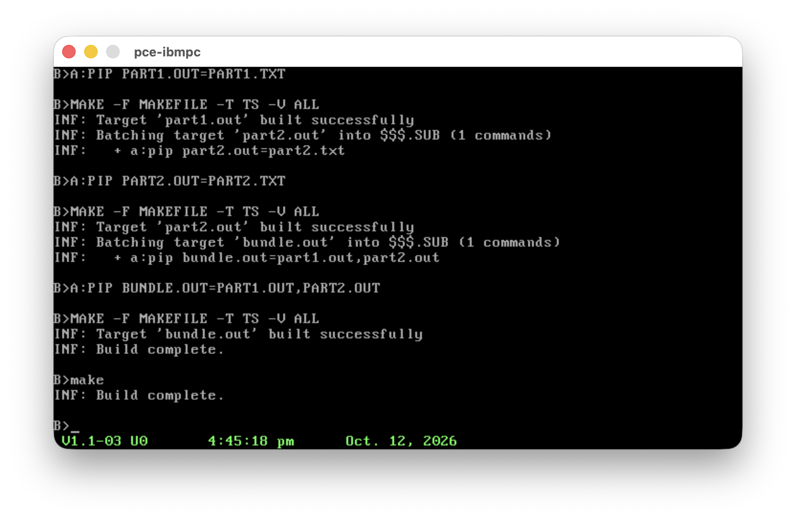
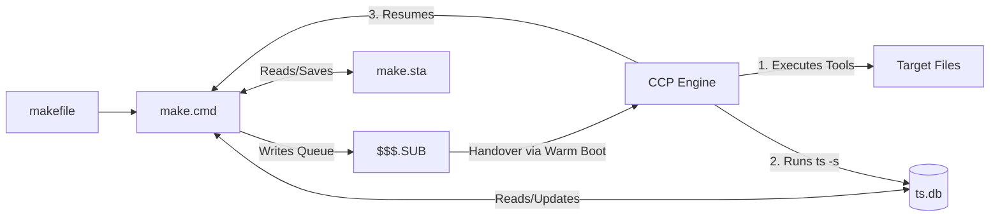
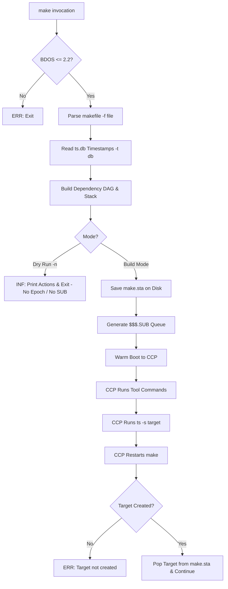
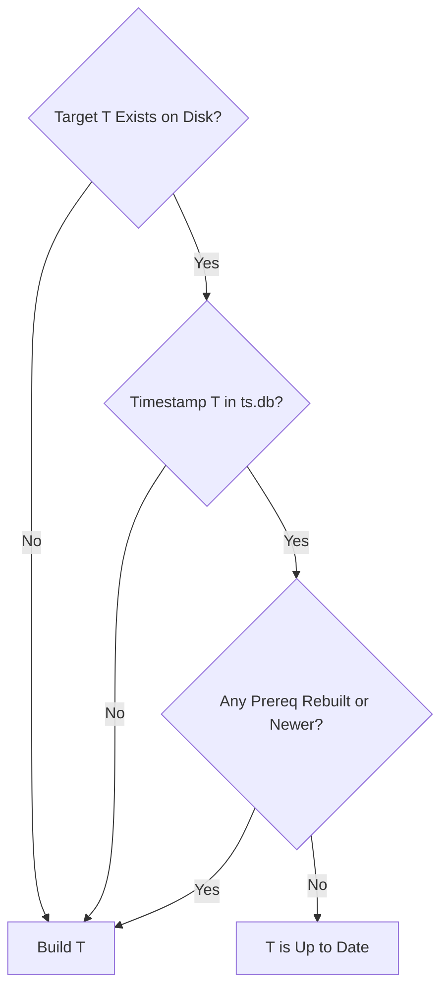

# CP/M-86 Make & Timestamp (ts)

Laconic build automation, state management, and timestamp tracking for CP/M-86 1.1+.

---

## Overview

CP/M-86 1.1 (BDOS 2.2) lacks file timestamps, sub-process execution (`fork`/`exec`), and process exit codes. 
`make` and `ts` resolve this through persistent indexed timestamps (`ndbm`), disk-backed state management (`make.sta`), and CCP batching (`$$$.SUB`).

This make will be enhanced to be forward compatible with BDOS >= 3.0 at a later stage.



---

## Command Reference

### `ts` (Timestamp Management Utility)

Manages persistent epoch modification timestamps stored in an `ndbm` database (`<db>.dir` / `<db>.pag`, default `ts`). Supports explicit timestamp values for testing in environments without BDOS clock support.

```
Usage:
  ts [-t db] <filepattern...>         Query timestamp for files (0 if not recorded)
  ts [-t db] -s <file> [timestamp]   Set file timestamp (system epoch or explicit value)
  ts [-t db] -d <filepattern...>       Delete file timestamp records
  ts [-t db] -l                       List all recorded timestamps
```

**Options:**
- `-t <db>`: Alternate timestamp database name (default: `ts`).
- `-s`: Stamp file with current system epoch (calls `epoch.lib` and enforces BDOS <= 2.2 guard if `[timestamp]` is omitted; uses given integer if specified).
- `-d`: Remove matching entries from database (supports wildcards `*`, `?`).
- `-l`: List all recorded timestamps in database.

**Examples:**
```
A>ts *.c                   ; Query timestamps for all C source files
A>ts -s foo.cmd            ; Record current epoch timestamp (requires clock/CP/M-86)
A>ts -s foo.cmd 1712000000 ; Record explicit simulated timestamp (no clock guard needed)
A>ts -t myproj -s main.o   ; Record timestamp in myproj.db
A>ts -d *.o                ; Delete all .o records from ts.db
```

---

### `make` (CP/M-86 Build Utility)

Evaluates prerequisite rules, tracks build state on disk via `state` API, and schedules batches via `$$$.SUB`.

```
Usage:
  make [-f makefile] [-t db] [-a] [-r] [-n] [-v] [target]
```

**Options:**
- `-f <file>`: Alternate makefile (default: `makefile`).
- `-t <db>`: Alternate timestamp database name (default: `ts`).
- `-a`: Unconditional rebuild (forces all targets to be rebuilt).
- `-r`: Reset build state (clears `make.sta`).
- `-n`: Dry run (test mode) - bypasses epoch retrieval, prints action plan without modifying disk or `$$$.SUB`.
- `-v`: Verbose mode - traces dependency evaluation, out-of-date reasons, and batch creation.
- `target`: Target to build (defaults to first target in `makefile`).

**Makefile Syntax & Variables:**

- **Explicit Rules Only**: In keeping with the minimalist CP/M-86 environment, all dependency rules and recipes must be explicit. Pattern rules (e.g. `%.o: %.c`) and suffix rules (e.g. `.c.o:`) are **not** supported.
- **Variable Definitions**: Defined at the top level using `NAME = VALUE` or `NAME=VALUE` (e.g. `PIP=a:pip`, `CC=cc -o $@`). Variable names are matched case-insensitively.
- **Variable Expansion**: Evaluated inside recipe command lines using `$(VAR)`, `${VAR}`, or `$V`.
- **Automatic Variables**:
  - `$@` : Evaluates to the target name.
  - `$<` : Evaluates to the first prerequisite name.
  - `$*` / `$^` : Evaluates to all prerequisites (space-separated).
  - `$$` : Literal `$` character.
- **Line Continuations**: Lines ending with `\` are joined with the subsequent line.

```makefile
# Simple dependency rule with variables and automatic macros
.phony: all clean

PIP=a:pip

all: bundle.out

bundle.out: part1.out \
	part2.out
	$(PIP) $@=part1.out,part2.out

part1.out: part1.txt
	$(PIP) $@=$<

part2.out: part2.txt
	$(PIP) $@=$*

clean:
	era *.out
	ts -d *.out
```

---

## Diagnostics Standard

Output follows `cmdinfo` format:
- `INF: <message>` : Normal status and information
- `WRN: <message>` : Non-fatal warning
- `ERR: <message>` : Fatal error leading to exit

---

## Build

Requires the `cpm86-crossdev` toolchain (`aztec42_cc`, `aztec42_link`, etc.).

The project also depends on the `util` library from
[cpm86-hacking](https://github.com/tsupplis/cpm86-hacking) and on the `ndbm`
library from [cpm86-ports](https://github.com/tsupplis/cpm86-ports). The
following files are taken from there and kept in this directory; they are not
built here:

| File | Source | Purpose |
|------|--------|---------|
| `util.lib` | cpm86-hacking | Library linked into `ts.cmd` and `make.cmd` |
| `util.h`, `conio.h`, `debug.h`, `dirent.h`, `epoch.h`, `gfx.h`, `sub.h` | cpm86-hacking | Headers used at compile time |
| `ndbm.lib` | cpm86-ports | Indexed timestamp database library linked into `ts.cmd` and `make.cmd` |
| `ndbm.h` | cpm86-ports | Header used at compile time |

```sh
make          # builds ts.cmd and make.cmd
make test     # runs regression test suite under emu2
make clean    # removes all generated files
```

---

## Architecture

### Component Interaction



### Execution Lifecycle



### Dependency Decision Logic



---

## Companion projects

| Project | Description |
|---------|-------------|
| [cpm86-kernel](https://github.com/tsupplis/cpm86-kernel)     | CP/M-86 1.1 distribution rebuilt from patched and reconstituted sources |
| [ccpm86-y2k](https://github.com/tsupplis/ccpm86-y2k)         | CCP/M-86 3.1 distribution rebuilt from patched and reconstituted sources |
| [cpm86-crossdev](https://github.com/tsupplis/cpm86-crossdev) | Unix CP/M-86 cross development project (compilers, emulation and tools) |
| [cpm86-hacking](https://github.com/tsupplis/cpm86-hacking)   | CP/M-86 miscellaneous tools and PCE emulator helpers |
| [cpm86-cmdtools](https://github.com/tsupplis/cpm86-cmdtools) | CP/M-86 `.cmd` file manipulation tools |
| [cpm86-ports](https://github.com/tsupplis/cpm86-ports)       | CP/M-86 application ports in C and assembler |
| [cpm86-vi](https://github.com/tsupplis/cpm86-vi)             | STevie vi port for CP/M-86 and PC-DOS 1.1 |
| [cpm86-msbasic](https://github.com/tsupplis/cpm86-msbasic)   | A recreaction of msbasic-86 for CP/M-86 and PC-DOS 1.1 from gwbasic sources |
| [cpm86-menu](https://github.com/tsupplis/cpm86-menu)   | A submit replacement and a menu system for submit orchestration for CP/M-86 1.1 |
| [cpm86-make](https://github.com/tsupplis/cpm86-make)   | A simple submit based make tool for CP/M-86 1.1 |
| [pcdos11-hacking](https://github.com/tsupplis/pcdos11-hacking) | PC-DOS 1.1 distribution, tools and notes |

## License

MIT — see [LICENSE](LICENSE.md).
